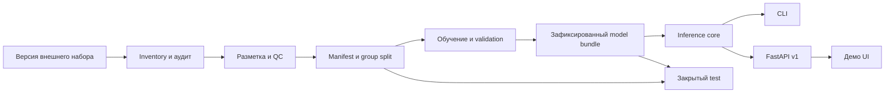

# Архитектура

## Решение

Модульный Python-проект с одним inference core. Для MVP достаточно CLI, FastAPI и простого Streamlit-интерфейса; UI обращается к API, API вызывает core. Обучение запускается отдельно и не является частью HTTP-запроса. Базы данных, очереди и Kubernetes не нужны до появления соответствующего сценария.



## Предлагаемая структура после реализации

```text
src/sealsign/
  data/          # inventory, import, annotations, split, validation
  training/      # train, experiment records
  evaluation/    # page-level evaluation, metrics, errors, benchmark
  inference/     # predictor, transforms, postprocess, model loading
  api/           # v1 endpoints, input limits, error mapping
  cli.py
apps/demo/       # клиент API
configs/         # параметры без секретов
schemas/         # версионированные контракты
scripts/         # повторяемые операции, не скрытая бизнес-логика
reports/         # результаты и разрешённые иллюстрации
artifacts/       # локальные веса и логи, gitignored
```

Predictor принимает RGB массив и параметры, возвращает список объектов в координатах исходного нормализованного изображения. Он не знает HTTP, UI, путей датасета. ModelAdapter инкапсулирует конкретный backend (PyTorch; позднее ONNX). Transform хранит scale/padding/tile origin; обратное преобразование проверяется тестами. Predictor загружается один раз при запуске worker, операции ограничиваются semaphore; на первом этапе последовательное выполнение.

## Выбор детектора

Основной кандидат: небольшой pretrained YOLO detector, например YOLO11s через Ultralytics. Зафиксировать точную модель, версию библиотеки и SHA-256 весов при реализации; проверить условия лицензирования кода и весов до распространения и интеграций. Это кандидат, а не уже проведённый выбор по экспериментам. Альтернатива при ограничениях лицензии/качества — Faster R-CNN через torchvision или RT-DETR с отдельно проверенной лицензией реализации и весов. Второй стек добавлять только по результатам пилота.

Причина выбора: доступное transfer learning, поддержка bbox, быстрый baseline и переносимость CPU/GPU. Риски: мелкие объекты на больших страницах и перекрытия. Решение: сначала baseline целой страницы, затем контролируемое сравнение увеличенного разрешения и tile inference. Не включать tiling без результатов и тестов координат.

## Model bundle

Содержит weights, labels={0:stamp,1:signature}, model card, effective config, preprocess specification, thresholds per class, NMS settings, dataset/annotation/split versions, commit, dependency lock и SHA-256. API проверяет class order и совместимость bundle при старте, прекращает запуск при несоответствии. Порог отображения в UI не перезаписывает bundle.

## Решения и расширения

ADR-001: bbox с независимыми перекрывающимися рамками; маски не нужны для задания. ADR-002: group split до аугментаций и тайлов. ADR-003: UI и интеграции используют один core и версию схемы. ADR-004: статические версии model bundle вместо обучения в сервисе. ADR-005: GPU необязателен для демонстрации.

Будущие PDF/OCR/СЭД-коннекторы преобразуют вход и выход вокруг core. Для долгих заданий добавятся job storage, очередь, object storage и идемпотентность. Их интерфейсы описаны в docs/06; в MVP не имитировать готовую инфраструктуру.
