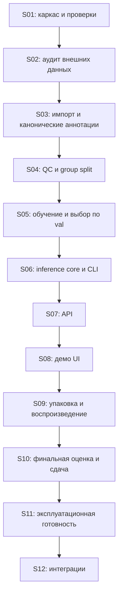

# Пошаговый план до готового продукта

Это основной порядок реализации. Детали требований остаются в [ТЗ](01-specification.md), [архитектуре](02-architecture.md), [протоколе обучения](04-training.md) и [плане проверки](07-verification.md). Календарь учебной сдачи — [до 19 ноября](10-two-week-execution.md). Здесь определены конкретные результаты, зависимости и условия перехода между этапами.

Текущее состояние: готова документация, реализован исполняемый каркас S01; детектор и обученная модель отсутствуют. Внешний набор ещё не прошёл аудит. Нельзя отмечать этап выполненным только потому, что создан файл с соответствующим названием.

## Что считать готовым продуктом

Для сдачи нужен локальный продукт, который устанавливается по README, загружает проверенный model bundle, принимает JPEG/PNG, находит печати и подписи, показывает рамки и confidence, экспортирует JSON/PNG и корректно обрабатывает ошибки. Вместе с ним поставляются воспроизводимые подготовка/обучение/оценка, реальные метрики и итоговый отчёт. Один inference core обслуживает CLI, API и UI. Работоспособность подтверждается на настоящих весах, а не только на заглушке.

Публичный многопользовательский сервис с PDF, очередями и СЭД — следующий выпуск после учебной сдачи. Для него предусмотрены отдельные этапы, которые не должны задерживать локальный продукт.

## Общий порядок

Каркас inference/API можно разрабатывать раньше на явно обозначенных fixtures, пока идёт QC или обучение. Но этапы S06–S10 не закрываются без проверки на реальном bundle; fixtures не являются результатами детекции.

## S01. Создать исполняемый каркас

**Вход:** AGENTS.md, docs/01, docs/02, schemas/prediction.schema.json.

1. Проверить текущее дерево и существующий код; не пересоздавать уже реализованные модули.
2. Создать Python package `src/sealsign`, `pyproject.toml`, совместимый lock и dev dependencies. Начальный выбор — Python 3.11, если выбранный ML backend его поддерживает; подтвердить установкой.
3. Реализовать CLI entrypoint `sealsign` с `--help` и `--version`; отсутствие весов не должно мешать справке.
4. Добавить конфигурацию логирования и отделить пути данных, артефактов и секретов от кода.
5. Настроить CI: установка из lock, lint и содержательные tests без GPU, внешних данных и сетевого скачивания весов.

**Результат:** пакет устанавливается в чистой среде, справка работает, CI проходит. README содержит только проверенные команды. **Переход:** другой процесс импортирует пакет без побочных запусков обучения.

## S02. Выбрать и проверить внешний набор

**Вход:** [исследование кандидатов](09-dataset-research.md). YAT-19 исключён пользователем.

1. Проверить первичную карточку Sig & Stamps, точную версию, лицензию, формат, доступ и размер загрузки. Не называть набор окончательно выбранным по одному стороннему README.
2. Получить разрешённую копию/экспорт, сохранить revision, download URL, checksum и дату в паспорте `reports/data/dataset-card.md`.
3. Посчитать уникальные исходные страницы, классы и объекты. Отделить аугментированные копии от оригиналов.
4. Просмотреть пилот до 200 страниц, проверить оба класса, полноту рамок, типы документов и качество сканов.
5. Выбрать источник или документированно перейти к резерву SignverOD/StaVer. При отсутствии лицензии/доступа записать конкретный блокер и продолжить независимый каркас, не объявлять корпус готовым.

**Результат:** паспорт с проверенными фактами и оценкой доразметки. **Переход:** данные доступны, условия использования установлены, оба класса представлены. После уточнения 06.11.2026 требуется не менее 5 000 уникальных исходных страниц; не генерировать копии ради этого минимума.

## S03. Реализовать импорт и конвертацию

**Вход:** принятый источник, docs/03, паспорт данных.

1. Реализовать безопасный импортёр и inventory: относительные пути, стабильные page_id, checksum, размеры, статус декодирования, provenance и original split.
2. Для segmentation exports получить отдельную bbox каждого экземпляра; CSV/COCO ID явно преобразовать в `0=stamp, 1=signature`.
3. Сохранить канонические аннотации и manifest; YOLO labels генерировать как производные данные.
4. Сделать validator и визуальный preview. Непроверенные и действительно пустые страницы имеют разные статусы.
5. Проверить повреждённый файл, выход пути из каталога, неверный class_id, координаты за границей и orientation/EXIF.

**Результат:** повторяемый импорт без ручного редактирования итоговых labels. **Переход:** количества до/после согласованы, исключения объяснены, ошибки конвертации отсутствуют.

## S04. Завершить QC и зафиксировать split

**Вход:** импортированный корпус, инструкция разметки.

1. Согласовать спорные типы объектов на общем пилоте; сохранить решения и примеры.
2. Проверить каждый используемый документ на оба класса. При объединении одноклассовых источников обязательно доразметить пропущенный класс.
3. Провести второй просмотр positive/disputed и выборки negatives согласно docs/03; спорные объекты решает человек.
4. Построить группы документов/дублей, выполнить split до tiles/augmentations; проверить пересечения и near duplicates.
5. Сохранить аннотации, split и QC report с hashes, counts и списком исключений. Закрыть test для настройки.

**Результат:** принятый обучающий корпус. **Переход:** в используемых данных нет unreviewed, unresolved и невалидных рамок; train/val/test не разделяют одну группу. Без этого полноценное обучение не запускается.

## S05. Реализовать обучение и провести эксперименты

**Вход:** принятый split; docs/04; фактическая RTX 4070 либо доступная GPU Colab.

1. Создать train/evaluate entrypoints, валидировать обязательные поля конфигурации; не принимать `null` из example config как готовый запуск.
2. Зафиксировать backend, начальные веса/hash, effective config и окружение; проверить VRAM и выполнить короткий benchmark.
3. Выполнить E00 overfit на 10–20 страницах, затем E01 baseline. Исправить формат/геометрию до полного обучения.
4. Провести доступные ablations E02–E04, меняя одну гипотезу. Записать реальные результаты в experiments.csv.
5. Выбрать модель и thresholds только по val. Собрать immutable bundle с labels, preprocessing, порогами, NMS, hashes и model card.
6. Подготовить Colab notebook, вызывающий те же entrypoints, с сохранением checkpoint и resume. Не дублировать ML-логику в notebook.

**Результат:** реально обученный кандидат и воспроизводимые логи. **Переход:** bundle загружается на CPU, class mapping совпадает, метрики val посчитаны; достигнутость предложенных целей указана честно.

## S06. Реализовать inference core и CLI

**Вход:** bundle, schema v1, docs/02 и docs/06.

1. Реализовать загрузку bundle, нормализацию изображения, preprocessing, predictor и postprocessing.
2. Восстановить bbox в исходные нормализованные координаты; сохранить перекрытия разных классов.
3. Реализовать `sealsign predict` для файла с JSON и overlay; параметры и синтаксис закрепить после проверки.
4. Проверить пустой результат, край страницы, нестандартное соотношение сторон, EXIF и class-aware NMS. Tiling подключать только после отдельного опыта и тестов merge/remap.
5. Выполнить CPU smoke run на настоящих весах и разрешённом изображении.

**Результат:** рабочий путь файл → модель → JSON/overlay без HTTP. **Переход:** JSON соответствует схеме, геометрия корректна, результаты не подменяются заглушкой.

## S07. Реализовать API

**Вход:** проверенный core, API contract docs/06.

1. Добавить FastAPI endpoints healthz/readyz/model/predict и runtime validation межполевых ограничений.
2. Загружать модель один раз на worker, ограничивать одновременные запросы и время обработки.
3. Проверять формат/размер/пиксели, возвращать согласованные коды ошибок, request_id; очищать временные файлы при успехе и исключении.
4. Проверить настоящим HTTP-запросом положительный пример, negative, повреждённый и чрезмерный файл, недоступную модель.

**Результат:** API использует тот же Predictor, что CLI. **Переход:** сквозной HTTP smoke с настоящими весами и проверки отказов проходят.

## S08. Сделать интерфейс демонстрации

**Вход:** работающий API.

1. Создать Streamlit client: загрузка, preview, анализ, overlay/легенда, список объектов, версия модели, скачивание JSON/PNG.
2. Обрабатывать загрузку и ошибки без дублирования inference и без вывода traceback пользователю.
3. Проверить отображение двух классов, отсутствие объектов, скачивание и смену файла; порог отображения не меняет эталонные метрики.
4. Подготовить разрешённые примеры успеха и ошибки и провести репетицию сценария docs/06.

**Результат:** пользователь выполняет основной сценарий без терминала. **Переход:** действие в UI вызывает реальный API и возвращает согласованный результат; сохранённые результаты обозначены явно.

## S09. Упаковать и воспроизвести

**Вход:** CLI/API/UI и bundle.

1. Подготовить CPU Docker image и Compose API/UI с readiness; GPU профиль необязателен для локальной защиты.
2. Проверить установку из lock и запуск по README в чистой среде. Не встраивать закрытые данные и секреты в image.
3. Организовать отдельное получение весов с hash; описать offline запуск и диагностику отсутствующих файлов.
4. Передать инструкции другому участнику и устранить обнаруженные пропуски. Сохранить протокол окружения и команд.

**Результат:** проверенный переносимый комплект. **Переход:** независимый запуск воспроизводит обработку страницы, ссылки и checksums работают.

## S10. Провести финальную приёмку и оформить сдачу

**Вход:** замороженный bundle, закрытый test и готовое приложение.

1. Выполнить финальную оценку без изменения модели по test; собрать поклассовые метрики, support, FP/page и latency с аппаратурой.
2. Составить галерею ошибок и ограничения. Если test уже изучался для настройки — раскрыть это, не объявлять его независимым.
3. Оформить итоговый отчёт по полученному кафедральному шаблону; заполнить реальный вклад участников.
4. Пройти матрицу docs/07, проверить Git на большие/приватные файлы, README и ссылки на веса.
5. Подготовить release notes с commit, bundle hash, известными ограничениями и инструкцией демонстрации.

**Результат:** локальный продукт и доказательства для сдачи. **Переход:** нет блокирующих дефектов сценария; все невыполненные требования явно перечислены. Недостигнутый целевой AP нельзя скрывать за удачными примерами.

## S11. Подготовить эксплуатационный выпуск после сдачи

Этот этап выполняется при запросе на реальное размещение; создание локального демо не означает готовность публичного сервиса.

1. Уточнить пользователей, объём, инфраструктуру, допустимые задержки, хранение и права доступа.
2. Реализовать authentication/authorization, TLS, rate limits, изоляцию tenant, retention и удаление; проверить права на данные/веса для выбранного использования.
3. Добавить structured logs без документов, metrics, alerts, resource limits и нагрузочную проверку на согласованном профиле.
4. Зафиксировать версии и rollback bundle/app; провести восстановление, документировать runbook и владельца поддержки.
5. Создать staging и выполнить приёмку. Публикацию выполнять после конкретной проверки настроек и в пределах разрешения владельца.

**Результат:** сервис с измеренными эксплуатационными характеристиками. **Переход:** нагрузка, контроль доступа, отказ модели, cleanup и rollback проверены на целевой среде; SLA не выдуман.

## S12. Добавлять интеграции отдельными выпусками

Выбирать по реальному потребителю, а не реализовывать всё сразу.

| Возможность | Что реализовать | Как принять |
|---|---|---|
| PDF | безопасный render, page_index, DPI, transform | рамки правильно переносятся между image/PDF coordinates |
| Batch CLI | JSONL по странице и журнал ошибок | ошибка одного файла не теряет остальные результаты |
| Async jobs | job storage, очередь, TTL, idempotency, retries | повтор запроса не создаёт двойную обработку; рестарт не теряет статус |
| OCR/СЭД | adapter к schema v1, IDs, crops, versioning | контрактный тест с реальным consumer и сохранением геометрии |
| ONNX | backend adapter и parity benchmark | оговорённые допуски и влияние на качество/скорость подтверждены |
| Дообучение | новые версии данных, QC, regression suite | улучшение на принятом validation protocol без скрытой утечки test |

## Управление выполнением

После каждого этапа обновлять [журнал исполнения](../templates/implementation-status.md): статус, evidence, команды, результаты, commit, блокеры и следующий шаг. `done` означает работающий и проверенный результат. `blocked` указывает конкретную зависимость; остальные независимые задачи продолжаются. Документация не заменяет исполнение, а успешный unit test не заменяет реальную проверку продукта.

Актуальное уточнение 06.11.2026: внешний корпус должен содержать **не менее 5 000 уникальных исходных страниц**. Это обязательный минимум, не достигаемый аугментациями или копированием; прежние формулировки об открытом объёме заменены этим решением (docs/08).
